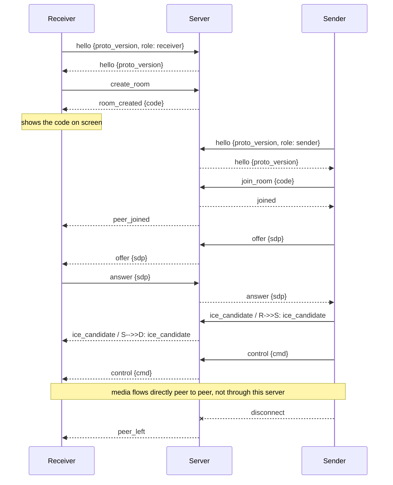

# Comet Cast signalling protocol (version 1)

The server only mediates: it hands out room codes and relays WebRTC
offer/answer/ICE and control messages between one receiver and one sender.
It never stores or forwards media, images or files. Code: `crates/cc-proto`
(messages) and `crates/cc-server` (server).

## Transport

- WebSocket at path `/ws`. Every message is one JSON **text** frame (binary frames are rejected).
- Each message is an object with a `"type"` field in `snake_case`.
- One receiver and one sender per room in v0.1.
- `GET /healthz` returns `200` with body `ok`.
- With `--web-dir <path>` the server also serves that directory as static files
  from the same address, so the web app and `/ws` share one origin.
- No TLS yet. HTTPS/WSS via rustls is a later step. UNCERTAIN: browsers are
  generally said to require a secure context (HTTPS) for screen capture, with
  `localhost` treated as secure; to be verified in the target browsers before relying on it.

## Messages

Client to server:

| type | fields | who | meaning |
|---|---|---|---|
| `hello` | `proto_version`, `role` (`sender`/`receiver`) | both | Must be the first message. |
| `create_room` | - | receiver | Ask for a new room. |
| `join_room` | `code` | sender | Join the room with this code (case-insensitive, 6 characters). |
| `offer` | `sdp` | both | WebRTC offer, relayed to the peer. |
| `answer` | `sdp` | both | WebRTC answer, relayed to the peer. |
| `ice_candidate` | `candidate` | both | ICE candidate, relayed to the peer. |
| `control` | `cmd` | both | Remote-control command, relayed to the peer. |

Server to client:

| type | fields | sent to | meaning |
|---|---|---|---|
| `hello` | `proto_version` | the client that said hello | Handshake accepted. |
| `room_created` | `code` | receiver | Show this code on screen. |
| `joined` | - | sender | Join succeeded. |
| `peer_joined` | - | receiver | A sender joined the room. |
| `offer` / `answer` / `ice_candidate` / `control` | as above | the other peer | Relayed unchanged. |
| `peer_left` | - | the remaining peer | The other side disconnected. |
| `error` | `code`, `message` | the client that caused it | See error codes. |

`ice_candidate.candidate` is an opaque string for the server. For browsers it
carries the JSON text of an `RTCIceCandidateInit` (`candidate`, `sdpMid`,
`sdpMLineIndex`). UNCERTAIN: for native WebRTC clients this is not decided; it
will be decided when `cc-transport` exists.

`control.cmd` uses serde's default enum form, e.g. `"stop"` for unit commands
and `{"go_to_page":{"page":3}}` for commands with data (see `ControlCmd`).

Relay messages work only when both sides are in the room. Otherwise the sender
of the message gets `error` `not_in_room` and nothing is forwarded.

## Sequence

Who sends the offer is up to the clients; the server does not care. (That media
goes peer to peer is the design goal; it is not checked by this server.)

## Rooms

- Codes are 6 characters from `ABCDEFGHJKLMNPQRSTUVWXYZ23456789`, generated by
  the server with a random source; on a collision it draws again.
- A room ends when its receiver disconnects. The sender, if present, gets `peer_left`.
- If the sender disconnects, the receiver gets `peer_left` and the room stays;
  a new sender may join with the same code.
- A room that has no sender for longer than the idle timeout is removed and its
  receiver's connection is closed with close reason `room_expired`.
- If the receiver leaves, the sender's connection stays open and may create/join
  another room on the same connection (it gets `peer_left` first).
- Rooms are in memory only; a server restart drops all rooms.
- There is no limit on the number of rooms yet (rate limiting for `Mode::Open`
  is milestone M8 / measurement point 8).

## Error codes

An `error` message is `{"type":"error","code":"...","message":"..."}`.
"Closes" means the server closes the connection after sending the error.

| code | when | closes |
|---|---|---|
| `bad_hello` | First message is not a valid `hello`, or no hello arrived in time. | yes |
| `proto_mismatch` | `proto_version` differs from the server's (currently 1). | yes |
| `wrong_role` | `create_room` from a sender, or `join_room` from a receiver. | no |
| `room_not_found` | `join_room` with a code that has no room. A code that is syntactically invalid (wrong length or characters) is treated the same way. A `code` that is not a string is `bad_message`. | no |
| `room_full` | `join_room` for a room that already has a sender. | no |
| `not_in_room` | A relay message while not in a room or while the peer is not there. | no |
| `bad_message` | Unparsable JSON, unknown type, binary frame, second `hello`, or `create_room`/`join_room` while already in a room. | no |

A message larger than the size limit makes the connection fail and close
without an `error` message.

## Limits (all configurable in `ServerConfig`)

| limit | default | status |
|---|---|---|
| Max message size | 64 KiB | UNCERTAIN: placeholder; check against real SDP sizes, measure. |
| Time to send a valid `hello` | 5 s | UNCERTAIN: placeholder; check on slow mobile networks. |
| Idle time of a room without sender | 30 min | UNCERTAIN: placeholder; needs real usage data. |
| Time a connection may stay in no room | 60 s | UNCERTAIN: placeholder, counted from connect time; closed with close reason `no_room_timeout` (no `error` message). |
| Queued outgoing messages per client | 256 | UNCERTAIN: placeholder. A client that does not read and fills the queue is disconnected (its peer gets `peer_left`). |

The hello deadline is fixed at connect time; WebSocket pings do not extend it.

## Not done yet

TLS, rate limiting and bot protection for open servers (M8), authentication
for internal servers, and more than one sender per room.
