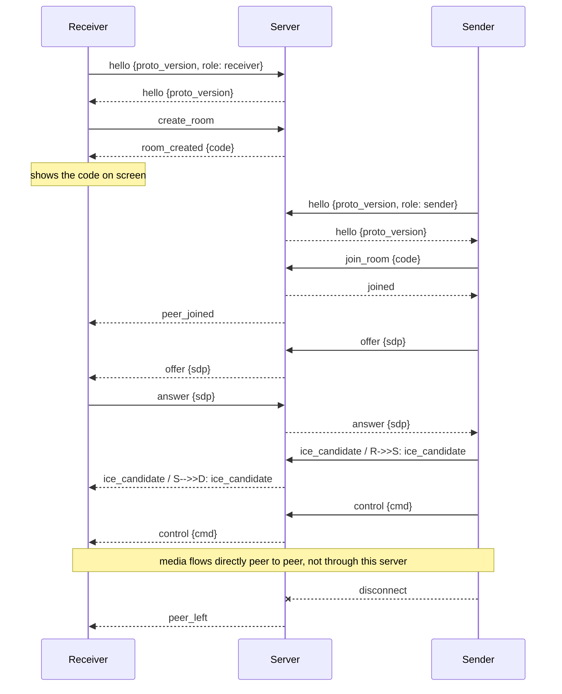

# Comet Cast signalling protocol (version 1)

The server only mediates: it hands out room codes and relays WebRTC
offer/answer/ICE and control messages between one receiver and one sender.
It never stores or forwards media, images or files. Code: `crates/cc-proto`
(messages) and `crates/cc-server` (server).

## Transport

- WebSocket at path `/ws`. Every message is one JSON **text** frame (binary frames are rejected).
- Each message is an object with a `"type"` field in `snake_case`.
- One receiver and one sender per room in v0.1.
- `GET /healthz` returns `200` with body `ok`.
- `GET /altcha/challenge` returns an ALTCHA puzzle (JSON); `GET /ice-servers` returns
  short-lived TURN credentials when the server has TURN configured (otherwise `404`).
  Both are described in [server.md](server.md). Any HTTP request can be answered with
  `403` (address not allowed or banned), `429` (rate limit, with `Retry-After`) or
  `503` (server full); the WebSocket upgrade can be refused the same way.
- With `--web-dir <path>` the server also serves that directory as static files
  from the same address, so the web app and `/ws` share one origin.
- TLS is optional: with a certificate configured the same paths are served as HTTPS and
  `wss://` (see [server.md](server.md)); without it the server speaks plain HTTP and `ws://`.
  UNCERTAIN: browsers are generally said to require a secure context (HTTPS) for screen
  capture, with `localhost` treated as secure; to be verified in the target browsers
  before relying on it.

## Messages

Client to server:

| type | fields | who | meaning |
|---|---|---|---|
| `hello` | `proto_version`, `role` (`sender`/`receiver`) | both | Must be the first message. |
| `create_room` | optional `altcha` (string) | receiver | Ask for a new room. `altcha` is the base64 text of a solved ALTCHA payload (see [server.md](server.md)). Servers in internal mode do not need it, open servers answer `altcha_required` without it. Clients that never send the field keep working with servers that do not require it. The web app and the native clients first send `create_room` without the field; after `altcha_required` they fetch and solve a puzzle and send `create_room` again on the same connection (the connection stays open after `altcha_required`). Payload and solving scheme: [web README](../apps/web/README.md#open-servers-and-turn) and [transport.md](transport.md). |
| `join_room` | `code` | sender | Join the room with this code (case-insensitive, 6 characters). |
| `offer` | `sdp` | both | WebRTC offer, relayed to the peer. |
| `answer` | `sdp` | both | WebRTC answer, relayed to the peer. |
| `ice_candidate` | `candidate` | both | ICE candidate, relayed to the peer. |
| `control` | `cmd` | both | Remote-control command, relayed to the peer. |

Server to client:

| type | fields | sent to | meaning |
|---|---|---|---|
| `hello` | `proto_version` | the client that said hello | Handshake accepted. |
| `room_created` | `code` | receiver | Show this code on screen. |
| `joined` | - | sender | Join succeeded. |
| `peer_joined` | - | receiver | A sender joined the room. |
| `offer` / `answer` / `ice_candidate` / `control` | as above | the other peer | Relayed unchanged. |
| `peer_left` | - | the remaining peer | The other side disconnected. |
| `error` | `code`, `message` | the client that caused it | See error codes. |

`ice_candidate.candidate` is an opaque string for the server. For browsers it
carries the JSON text of an `RTCIceCandidateInit` (`candidate`, `sdpMid`,
`sdpMLineIndex`). Native clients (`cc-transport`) send the same JSON, so no protocol
change was needed; they send `sdpMid` as `null` and set `sdpMLineIndex` to 0 (one bundled
transport). UNCERTAIN: this is verified only for one video m-line against Chromium;
audio or data m-lines are not tested (see docs/transport.md).

`control.cmd` uses serde's default enum form, e.g. `"stop"` for unit commands
and `{"go_to_page":{"page":3}}` for commands with data (see `ControlCmd`).

Relay messages work only when both sides are in the room. Otherwise the sender
of the message gets `error` `not_in_room` and nothing is forwarded.

## Sequence

Who sends the offer is up to the clients; the server does not care. (That media
goes peer to peer is the design goal; it is not checked by this server.)

## Rooms

- Codes are 6 characters from `ABCDEFGHJKLMNPQRSTUVWXYZ23456789`, generated by
  the server with a random source; on a collision it draws again.
- A room ends when its receiver disconnects. The sender, if present, gets `peer_left`.
- If the sender disconnects, the receiver gets `peer_left` and the room stays;
  a new sender may join with the same code.
- A room that has no sender for longer than the idle timeout is removed and its
  receiver's connection is closed with close reason `room_expired`.
- If the receiver leaves, the sender's connection stays open and may create/join
  another room on the same connection (it gets `peer_left` first).
- Rooms are in memory only; a server restart drops all rooms.
- The number of rooms is capped (`limits.max_rooms`, see [server.md](server.md));
  `create_room` beyond the cap gets `rate_limited`.

## Error codes

An `error` message is `{"type":"error","code":"...","message":"..."}`.
"Closes" means the server closes the connection after sending the error.

| code | when | closes |
|---|---|---|
| `bad_hello` | First message is not a valid `hello`, or no hello arrived in time. | yes |
| `proto_mismatch` | `proto_version` differs from the server's (currently 1). | yes |
| `wrong_role` | `create_room` from a sender, or `join_room` from a receiver. | no |
| `room_not_found` | `join_room` with a code that has no room. A code that is syntactically invalid (wrong length or characters) is treated the same way. A `code` that is not a string is `bad_message`. | no |
| `room_full` | `join_room` for a room that already has a sender. | no |
| `not_in_room` | A relay message while not in a room or while the peer is not there. | no |
| `altcha_required` | `create_room` without `altcha` on a server that requires it (always the case in open mode). Added in M8; clients that do not know the code should treat it like any error. | no |
| `altcha_invalid` | `create_room` with an `altcha` payload that is malformed, wrongly signed, expired, not solved or already used. | no |
| `rate_limited` | Too many `create_room` / `join_room` messages from this address, or the server has reached its maximum number of rooms. The message text says which. Try again later. | no |
| `banned` | Too many failed joins: the address is banned for a while. | yes |
| `bad_message` | Unparsable JSON, unknown type, binary frame, second `hello`, or `create_room`/`join_room` while already in a room. | no |

A message larger than the size limit makes the connection fail and close
without an `error` message.

The server may also close a connection (close frame, text = reason, no `error` message) with
reason `ping_timeout` (client did not answer pings), `idle_timeout` (nothing relayed in the
room for too long), `room_lifetime` (room reached its maximum age), `room_expired` or
`no_room_timeout` (see above). A connection that sends too fast, too much, or too many bad
messages gets `rate_limited` (or `banned`) and is closed. See [server.md](server.md).

## Limits (all configurable, see [server.md](server.md); rate limits and bans are described there)

| limit | default | status |
|---|---|---|
| Max message size | 64 KiB | UNCERTAIN: placeholder; check against real SDP sizes, measure. |
| Time to send a valid `hello` | 5 s | UNCERTAIN: placeholder; check on slow mobile networks. |
| Idle time of a room without sender | 30 min | UNCERTAIN: placeholder; needs real usage data. |
| Time a connection may stay in no room | 60 s | UNCERTAIN: placeholder, counted from connect time; closed with close reason `no_room_timeout` (no `error` message). |
| Queued outgoing messages per client | 256 | UNCERTAIN: placeholder. A client that does not read and fills the queue is disconnected (its peer gets `peer_left`). |

The hello deadline is fixed at connect time; WebSocket pings do not extend it.

## Not done yet

Authentication for internal servers, ALTCHA when joining a room (only `create_room`
needs it today), and more than one sender per room. The web app, the native cores and the CLI
solve ALTCHA for `create_room` and use `GET /ice-servers` (see [transport.md](transport.md)); the
`cc-ffi` and the Flutter apps were not changed here; `cc-ffi` still compiles (it uses
`ReceiverOptions::new` / `SenderOptions::new`) and so gets ALTCHA solving and the TURN list from the Rust
cores without changes. UNCERTAIN: the Flutter apps were not built or run against an open server. See [server.md](server.md) for
what is built for open servers and what is still open.
