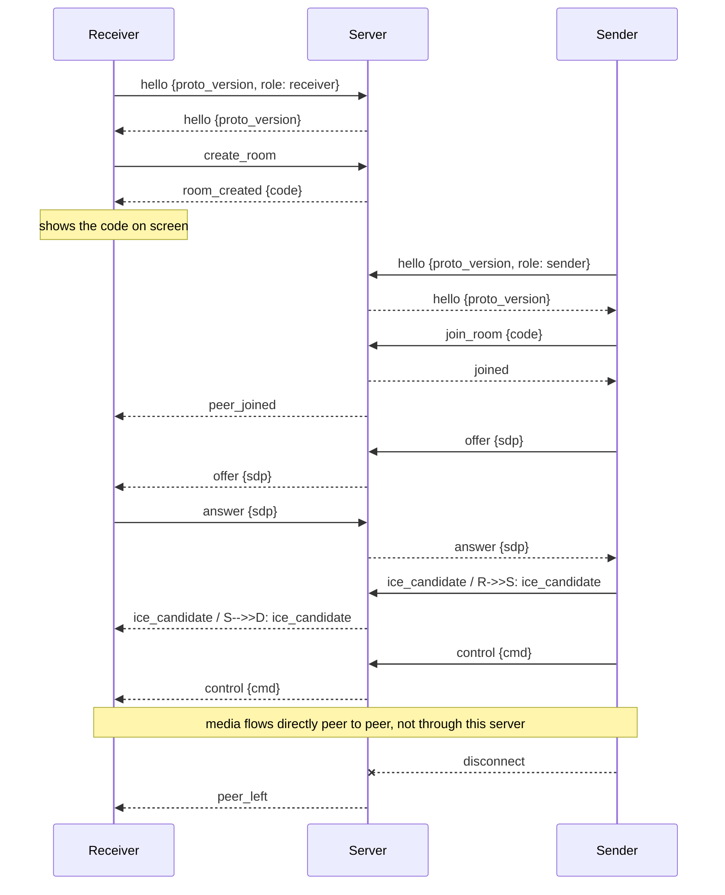
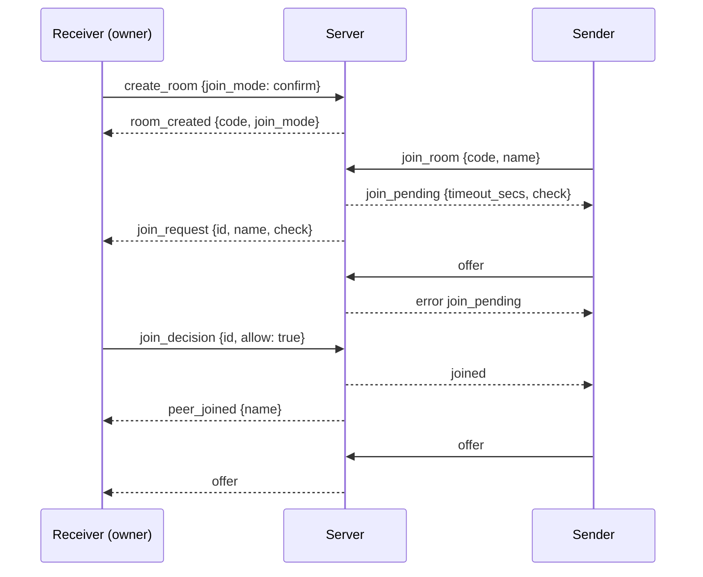

# Comet Cast signalling protocol (version 2)

The server only mediates: it hands out room codes and relays WebRTC
offer/answer/ICE and control messages between one receiver and one sender.
It never stores or forwards media, images or files. Code: `crates/cc-proto`
(messages) and `crates/cc-server` (server).

Version 2 added **join approval** (the display device decides who may join, see
[Join approval](#join-approval)). The project is at version 0.1, so there is no compatibility
with version 1: a client that says `proto_version` 1 gets `proto_mismatch`.

The optional `room_name` field (see [Room name](#room-name)) is **additive**: it is optional in
every message that carries it, an older client ignores it and an older server never sends it. It
needs no new protocol version, so `proto_version` stays 2 (the project needs no backwards
compatibility, and a new optional field does not break any version-2 client or server anyway).

## Transport

- WebSocket at path `/ws`. Every message is one JSON **text** frame (binary frames are rejected).
- Each message is an object with a `"type"` field in `snake_case`.
- One receiver and one sender per room (no change in version 2: several waiting senders are possible, only one is let in).
- `GET /healthz` returns `200` with body `ok`.
- `GET /altcha/challenge` returns an ALTCHA puzzle (JSON); `GET /ice-servers` returns
  short-lived TURN credentials when the server has TURN configured (otherwise `404`).
  Both are described in [server.md](server.md). Any HTTP request can be answered with
  `403` (address not allowed or banned), `429` (rate limit, with `Retry-After`) or
  `503` (server full); the WebSocket upgrade can be refused the same way.
- With `--web-dir <path>` the server also serves that directory as static files
  from the same address, so the web app and `/ws` share one origin.
- TLS is optional: with a certificate configured the same paths are served as HTTPS and
  `wss://` (see [server.md](server.md)); without it the server speaks plain HTTP and `ws://`.
  UNCERTAIN: browsers are generally said to require a secure context (HTTPS) for screen
  capture, with `localhost` treated as secure; to be verified in the target browsers
  before relying on it.

## Messages

Client to server:

| type | fields | who | meaning |
|---|---|---|---|
| `hello` | `proto_version`, `role` (`sender`/`receiver`) | both | Must be the first message. |
| `create_room` | optional `altcha` (string), optional `join_mode`, optional `room_name` (string) | receiver | Ask for a new room. `altcha` is the base64 text of a solved ALTCHA payload (see [server.md](server.md)). Servers in internal mode do not need it, open servers answer `altcha_required` without it. Clients that never send the field keep working with servers that do not require it. The web app and the native clients first send `create_room` without the field; after `altcha_required` they fetch and solve a puzzle and send `create_room` again on the same connection (the connection stays open after `altcha_required`). Payload and solving scheme: [web README](../apps/web/README.md#open-servers-and-turn) and [transport.md](transport.md). `join_mode` (`open`, `confirm`, `locked`) sets who may join; without it the server's `default_join_mode` applies (see [Join approval](#join-approval)). `room_name` is the name of the room as the display device shows it; senders get it back (see [Room name](#room-name)). |
| `join_room` | `code`, optional `name`, optional `handover` | sender | Join the room with this code (case-insensitive, 6 characters). `name` is shown to the display device when it has to approve; the server cleans it. `handover` is the single-use token of the iOS broadcast extension (at most 64 characters of `A-Z a-z 0-9 - _`, otherwise dropped); the server relays it to the display, which decides ([Hand-over token](#hand-over-token-ios-broadcast-extension)). Older servers ignore the field. |
| `set_join_mode` | `join_mode` | receiver (owner) | Change who may join, at any time. |
| `join_decision` | `id` (optional), `allow`, optional `block` | receiver (owner) | Allow or deny the waiting request `id`. Without `id`, `allow: false` denies all waiting requests. `block: true` (only with `allow: false` and an `id`) also blocks the sender's address bucket for the rest of this room session. |
| `remove_peer` | optional `block` | receiver (owner) | End the connected sender's presentation: remove it from the room (the room stays). With `block: true` its address bucket is blocked too. |
| `unblock` | `id` | receiver (owner) | Take an entry off the room's block list. |
| `end_room` | - | receiver (owner) | End the room session: everybody is dropped, the code is gone, the owner may create a new room on the same connection. |
| `cancel_join` | - | sender | Stop waiting for approval. |
| `offer` | `sdp` | both | WebRTC offer, relayed to the peer. |
| `answer` | `sdp` | both | WebRTC answer, relayed to the peer. |
| `ice_candidate` | `candidate` | both | ICE candidate, relayed to the peer. |
| `control` | `cmd` | both | Remote-control command, relayed to the peer. |

Server to client:

| type | fields | sent to | meaning |
|---|---|---|---|
| `hello` | `proto_version` | the client that said hello | Handshake accepted. |
| `room_created` | `code`, `join_mode` | receiver | Show this code on screen. `join_mode` is the mode the room really has. |
| `joined` | optional `room_name` | sender | Join succeeded (in `confirm` mode: the host allowed it). `room_name` is the cleaned name of the room; absent when the display device set none. |
| `peer_joined` | `name`, optional `handover` | receiver | A sender is in the room now. `name` is the cleaned display name (`Guest N` if none). `handover` is the hand-over token the sender joined with, relayed only when the join needed no decision (mode `open`); see [Hand-over token](#hand-over-token-ios-broadcast-extension). |
| `join_pending` | `timeout_secs`, `check`, optional `room_name` | sender | The join waits for the host's decision. `check` is a two-digit number (10 to 99) that the display shows on the request too. `room_name` as in `joined`. |
| `join_request` | `id`, `name`, `check`, optional `handover` | receiver (owner) | Somebody wants to join (mode `confirm`). Nothing else about the joiner is passed on, except the optional hand-over token of the join (see [Hand-over token](#hand-over-token-ios-broadcast-extension)). |
| `join_request_cancelled` | `id`, `reason` | receiver (owner) | A waiting request is gone: `left`, `cancelled`, `timeout`, `locked` or `room_full`. |
| `join_mode_changed` | `join_mode` | receiver (owner) | Answer to `set_join_mode`: the mode now in force. |
| `blocked` | `id`, `name` | receiver (owner) | An entry was added to the block list (after "No and block" or `remove_peer` with `block`). `name` is the cleaned name, for the list only. |
| `unblocked` | `id` | receiver (owner) | Answer to `unblock`. |
| `room_ended` | - | receiver (owner) | Answer to `end_room`: the room is gone; the connected sender got `peer_left`, waiting senders `room_not_found`. |
| `offer` / `answer` / `ice_candidate` / `control` | as above | the other peer | Relayed unchanged. |
| `peer_left` | - | the remaining peer | The other side disconnected. |
| `error` | `code`, `message` | the client that caused it | See error codes. |

`ice_candidate.candidate` is an opaque string for the server. For browsers it
carries the JSON text of an `RTCIceCandidateInit` (`candidate`, `sdpMid`,
`sdpMLineIndex`). Native clients (`cc-transport`) send the same JSON, so no protocol
change was needed; they send `sdpMid` as `null` and set `sdpMLineIndex` to 0 (one bundled
transport). UNCERTAIN: this is verified only for one video m-line against Chromium;
audio or data m-lines are not tested (see docs/transport.md).

`control.cmd` uses serde's default enum form, e.g. `"stop"` for unit commands
and `{"go_to_page":{"page":3}}` for commands with data (see `ControlCmd`).

Relay messages work only when both sides are in the room. Otherwise the sender
of the message gets `error` `not_in_room` and nothing is forwarded.

## Sequence

Who sends the offer is up to the clients; the server does not care. (That media
goes peer to peer is the design goal; it is not checked by this server.)

## How the room code works (investigated 2026-11)

This section records what the code does today, read from `crates/cc-server/src/rooms.rs` and
`ws.rs`. Some people expect the code to change every few minutes. **It does not.**

| Question | Answer |
|---|---|
| Does it rotate? | No. A room keeps its code until it ends. There is no timer that changes it. |
| How long does a code live? | Until the receiver disconnects, or the room is removed: no sender for `idle_room_secs` (30 min by default), or `max_room_lifetime_secs` (12 h in open mode, 24 h in internal mode) at the latest. After a sender left, the same code accepts a new sender (web receiver). The native receiver core ends when its sender leaves, so a native receiver shows a new code for every session; the web receiver does not. |
| How is it made? | 6 characters from a 32-symbol alphabet, drawn with the `rand` crate's thread RNG (documented there as cryptographically secure; UNCERTAIN: not audited here). 32^6 = 2^30, about 1.07 billion codes (30 bits). A collision with a live room is redrawn. |
| One sender or many? | One sender per room. A second `join_room` gets `room_full`. |
| What could a joiner send before it was accepted? | In version 1 nothing was held back: after `join_room` the sender was a normal peer at once, so everybody who knew the code could relay `offer`, `answer`, `ice_candidate` and `control` messages (`control` includes page commands and `stop`) to the receiver, which then answered the offer. In version 2 the default mode is still `open` and behaves like that; `confirm` and `locked` close this gap (see below). |
| How is guessing limited? | Failed joins count toward per-address bans (default 10 per 10 minutes in open mode, 30 in internal mode, escalating 1 / 5 / 30 minutes) and toward a server-wide brake; IPv6 is counted per /64 and /48. A rough figure: with 100 live rooms one random guess hits some room with probability about 100 / 2^30, i.e. 1e-7. UNCERTAIN: this is arithmetic on the defaults, not a measured or reviewed attack analysis. Anyone who has *seen* the code (a screenshot, a photo of the display) needs no guessing: that is what join approval is for. |

**Optional "new code every N minutes / after each session":** not built. A rotating code
would not stop somebody who already joined and would need every client to cope with a code
that changes under a person who is typing it. The tools for the same goal are the join modes
(lock after the wanted presenter is in) and removing a peer; a native receiver already gets a
new code per session, and the web receiver can start a new room with its "Stop" button.

## Room name

`create_room` may carry `room_name`: the name that the display device (receiver) shows for its room, for example `Meeting room Elbe`. It exists so that a presenter's pages can say where they are connected to without ever showing the room code in its place.

- **Cleaning (server).** Untrusted text, cleaned exactly like the display `name`: control, bidi, zero-width, invisible and private-use characters are removed, white space is collapsed and trimmed, and the result is **cut at 32 characters** (characters, not bytes; no trailing space after the cut). If nothing is left, or the field is absent or `null`, the room has no name. A value that is not a string is a `bad_message` like any other malformed message. There is no placeholder name.
- **Stored in the room**, not tied to the connection; it never changes during the room's life (a new room, for example after `end_room`, may have another name).
- **Relayed** to senders as optional `room_name` in `join_pending` (when the room needs approval) and in `joined`, always the cleaned value. It is **absent** when the room has no name. `room_created` does not echo it, and `join_request` to the owner does not carry it. It is not part of the QR URL.
- **Clients.** Show it as plain text only. A client works without it: a missing, `null`, empty or non-string `room_name` in a server message means "no room name" (the rest of the message is still valid). The web app and the Swift core apply this rule; presenter pages then show no room at all, never the code. Vectors: `tests/fixtures/join-approval/room-name-sanitising.json`, `messages.json` and `tests/fixtures/signaling.json`.
- **Native API.** `ReceiverOptions::room_name` (cc-receiver) sets it; `JoinProgress::Pending { room_name, .. }` and `SenderCore::room_name()` / `ContentSender::room_name()` (cc-sender) expose it.

## Join approval

Added in version 2. The room owner (the receiver that created it, usually a display device)
chooses who may join, and may change the choice at any time.

| mode | meaning |
|---|---|
| `open` | `join_room` succeeds at once. The sender is a peer immediately. The default everywhere. |
| `confirm` | The server holds every joiner in a **pending** state until the owner allows or denies it. |
| `locked` | `join_room` is answered with `room_locked`. |

The server enforces this; a client cannot skip it.

- **Who is the owner.** Only the connection that created the room (`create_room`) may send `set_join_mode`, `join_decision` and `remove_peer`. The server checks the connection, not any name or id in a message. A sender gets `wrong_role`; a receiver connection that does not own a room gets `not_in_room`; request ids are room-local, so an owner cannot touch another room.
- **What a pending joiner can do.** Nothing is relayed. `offer`, `answer`, `ice_candidate` and `control` get `join_pending` back and never reach the owner. It may send `cancel_join`, or disconnect.
- **What the owner learns.** Only `join_request { id, name, check }`. `name` is untrusted text: the server removes control, bidi, zero-width and invisible characters (and the private-use range), collapses white space, cuts at 40 characters and uses `Guest N` (N counts joiners of the room) when nothing is left. Clients must show it as plain text (no markup). The IP address and everything else about the joiner stay on the server.
- **Room name.** See [Room name](#room-name).
- **Check number.** The server draws a two-digit number (10 to 99) per pending request, unique among the room's waiting requests, and sends it to the owner (`join_request.check`) and to the joiner (`join_pending.check`). A person at the display can match the person in front of them with the request. It is not a secret and not an authentication.
- **Decision.** `join_decision {id, allow:true}` makes the joiner a peer: it gets `joined`, the owner gets `peer_joined`, and relaying starts. `allow:false` gives the joiner `join_denied`. All other waiting requests then get `room_full` (one sender per room) and the owner gets `join_request_cancelled` with reason `room_full`. A join into a room that already has a sender gets `room_full` at once, in every mode.
- **No and block.** `join_decision {id, allow:false, block:true}` denies the request and puts the sender's address bucket (an IPv4 address, or an IPv6 /64) on the room's block list for the rest of the room session. Other waiting requests from the same bucket end with `join_request_cancelled` reason `blocked`. A blocked sender gets `join_denied` at once (in modes `open` and `confirm`; a locked room still answers `room_locked` to everybody), is not shown to the host, and counts toward the same cooldown as a denial. `remove_peer {block:true}` blocks the connected sender the same way. The owner gets `blocked {id, name}` and can `unblock {id}`. The list lives as long as the room: `end_room` or a new room starts with an empty list. UNCERTAIN: blocking works by network address, not by device, so everybody behind the same address (a shared NAT or a /64) is blocked too and a person on another network is not; the name is only a label for the list. The list is capped at 32 entries.
- **End the presentation, end the session.** `remove_peer` ends the connected sender's presentation (it gets `removed_by_host`, the owner gets `peer_left`, the room and its code stay). `end_room` ends the room session: the connected sender gets `peer_left`, waiting senders `room_not_found`, the owner `room_ended`; the code is gone and the same connection may send `create_room` again for a new code. The native receiver core ends with the session either way (one sender per core), so the native apps start a new room at once. A join request that arrives while a sender is connected gets `room_full` (one sender per room): the host ends the presentation first.
- **Mode changes.** `set_join_mode` is answered with `join_mode_changed`. `locked` ends all waiting requests (`room_locked` to the joiners, `join_request_cancelled` reason `locked` to the owner) but does not remove a sender who is already in. `open` and `confirm` do not auto-approve waiting requests. There is no "lock" for a sender who is in: use `remove_peer` (the sender gets `removed_by_host` and has to join again; the room stays; on the native receiver core the session ends instead, see [How the room code works](#how-the-room-code-works-investigated-2026-11)).
- **Limits.** `limits.max_pending_per_room` (8) and `limits.max_pending_per_ip` (3 open, 8 internal) bound waiting requests; beyond that `join_room` gets `rate_limited`. Pending requests time out after `join_approval_secs` (60 s): the joiner gets `approval_timeout`, the owner `join_request_cancelled` reason `timeout`. A denied or timed-out request counts `limits.denied_join_weight` (2) failures toward the address ban, so repeated denials or timeouts lead to a cooldown (`banned`, connection closed) using the same machinery as failed joins; `join_room` itself is still subject to the usual join rate limit. UNCERTAIN: many people behind one address share this budget; the weight is a placeholder.
- **Server settings.** `default_join_mode` (`open` by default; `confirm` allowed; never `locked`) is the mode of rooms whose creator names none; `allow_open_rooms = false` makes the server refuse `open` (`open_rooms_disabled`) for operators who want approval everywhere (then `default_join_mode` must be `confirm`). See [server.md](server.md).
- **Client defaults.** The web app, the Flutter app and the CLI send `join_mode: "open"` unless the person chose something else (they remember the last choice as a convenience).
- **What the display should do** (not enforced by the server): the join request dialog of [design/first-run-and-display.md](design/first-run-and-display.md) (section 4.4): a dialog over the idle screen or the running presentation with the name in quotes, the check number, "+N waiting", Yes (focused), No and No and block; ignore input for 1 s after a request appeared; one press of Yes allows; a request that nobody answers leaves the queue (the server's `join_approval_secs`, 60 s by default). The web app follows this spec (`apps/web`); whether the Flutter and Apple TV apps do was not checked when this was written (they came first).

Exact message shapes and test vectors for other implementations (for example a Swift client)
are in `tests/fixtures/join-approval/*.json`; `crates/cc-proto` and
`crates/cc-server/tests/join_approval.rs` check the same shapes.

### Hand-over token (iOS broadcast extension)

Added for the iOS screen broadcast (decision N32, [native-apps.md](design/native-apps.md) 20.5). The ReplayKit extension has to join the room on its **own** connection, because iOS suspends the app while another app is in front, but the host must still approve a person once. So the app hands its approval over with a single-use token:

1. The app (a joined sender) opens a content `control` data channel and sends `{"kind":"handover","token":T}`. `T` is 128 random bits as base64url without padding (22 characters of `A-Z a-z 0-9 - _`); the sender makes it. A receiver that holds it answers `{"kind":"handover_ok"}` and does not forward the message to the application (an old or a web receiver does not answer, and the sender goes on after about four seconds). The message parser in `cc-files` knows both kinds (1 to 64 base64url characters; anything else is an invalid message).
2. The app leaves. The receiver sees the token as stored for this presenter and treats the leave as no leave for the host (no `toast.left`; the display stays on black for at most 60 s if something was shown).
3. The extension sends `join_room` with the person's `name` and the optional field **`handover`** (at most 64 characters of the base64url alphabet; anything else is **dropped** by the server and the join goes on as an ordinary join). The server relays the field unchanged: in `join_request` (mode `confirm`) or in `peer_joined` (mode `open`, where no request is made). **The server never stores, mints or checks a token**: it does not change who may join. In mode `locked` the join is refused as for everybody.
4. The receiver, not the server, decides: a token it stored, **not older than 60 s**, **unused** and **issued to the same presenter name** (the server cleans names, so both sides see the same text; two joiners without a name, `Guest N` with different numbers, count as the same person) is taken out of the store and the join is let in without a dialog (`join_decision allow`, no `toast.connected`). Anything else (no token, expired, replayed, another name, a token of another room) is an ordinary join request for the host. A wrong attempt does not consume the right person's token.
5. Before it leaves, the extension asks the receiver for a new token the same way, over the control channel of its media connection, and the app joins with it afterwards ("What to show", no dialog). Without an answer the app joins with the room code like Connect.

Bounds: a receiver keeps at most 4 tokens, one per presenter name (a newer one replaces the older), and refuses a token it holds already. The join itself is subject to the usual join rate limits and ban machinery, so guessing 128-bit tokens is not a way in. Fixtures: `tests/fixtures/join-approval/messages.json` (entries `*_with_handover`, marked `decoders_may_drop`: the web client and the Apple TV core read the field or ignore it); tests: `crates/cc-proto`, `crates/cc-server/tests/join_approval.rs` (relay, bounds, no skipping of the host), `crates/cc-receiver/tests/handover.rs` (single use, replay, another room, another name, expiry, Open and Approval on) and `crates/cc-ios/tests/loopback.rs` (the extension engine). UNCERTAIN: the web display does not hold tokens yet (it ignores the field and the control message), so iOS against a web display falls back to the waiting page with the extension's check number.

### Receive paths with their own approval

Join approval covers **Comet Cast protocol connections only** (web, Flutter, CLI and the Apple
TV app through this server). Other receive paths have their own mechanisms and are not
affected by `join_mode`, `remove_peer` or room locks: AirPlay through UxPlay has its own PIN
setting of UxPlay, Miracast has the Windows connection consent (see [miracast.md](miracast.md)),
Google Cast is started by the sender's own app (see [cast.md](cast.md)). UNCERTAIN: which of
these a given deployment enables depends on the settings of those programs, which this
document does not check.

## Rooms

- Codes are 6 characters from `ABCDEFGHJKLMNPQRSTUVWXYZ23456789`, generated by
  the server with a random source; on a collision it draws again.
- A room ends when its receiver disconnects. The sender, if present, gets `peer_left`; senders that wait for approval get `room_not_found`.
- If the sender disconnects, the receiver gets `peer_left` and the room stays;
  a new sender may join with the same code.
- A room that has no sender for longer than the idle timeout is removed and its
  receiver's connection is closed with close reason `room_expired`.
- If the receiver leaves, the sender's connection stays open and may create/join
  another room on the same connection (it gets `peer_left` first).
- Rooms are in memory only; a server restart drops all rooms.
- The number of rooms is capped (`limits.max_rooms`, see [server.md](server.md));
  `create_room` beyond the cap gets `rate_limited`.

## Error codes

An `error` message is `{"type":"error","code":"...","message":"..."}`.
"Closes" means the server closes the connection after sending the error.

| code | when | closes |
|---|---|---|
| `bad_hello` | First message is not a valid `hello`, or no hello arrived in time. | yes |
| `proto_mismatch` | `proto_version` differs from the server's (currently 2). | yes |
| `wrong_role` | `create_room` from a sender, or `join_room` from a receiver; also `set_join_mode`, `join_decision` or `remove_peer` from a sender, and `cancel_join` from a receiver. Counts as a bad message. | no |
| `room_not_found` | `join_room` with a code that has no room. A code that is syntactically invalid (wrong length or characters) is treated the same way. A `code` that is not a string is `bad_message`. | no |
| `room_full` | `join_room` for a room that already has a sender. | no |
| `not_in_room` | A relay message while not in a room or while the peer is not there. | no |
| `altcha_required` | `create_room` without `altcha` on a server that requires it (always the case in open mode). Added in M8; clients that do not know the code should treat it like any error. | no |
| `altcha_invalid` | `create_room` with an `altcha` payload that is malformed, wrongly signed, expired, not solved or already used. | no |
| `altcha_too_hard` | Client-side only, never sent by the server: the puzzle from `GET /altcha/challenge` asks for more work than the client accepts (`cost` above 10 000 or `keyLength` above 64, see [transport.md](transport.md)). | no |
| `altcha_expired` | Client-side only: the puzzle's `expiresAt` was already in the past on arrival (also happens when the device clock is far ahead). | no |
| `rate_limited` | Too many `create_room` / `join_room` messages from this address, the server has reached its maximum number of rooms, or too many senders already wait for approval (per room or per address). The message text says which. Try again later. | no |
| `banned` | Too many failed joins, or too many denied / unanswered join requests: the address is banned for a while. | yes |
| `join_pending` | A sender that waits for approval tried to relay `offer`, `answer`, `ice_candidate` or `control`. Nothing is forwarded. | no |
| `join_denied` | The host denied the join request. Also the answer to a sender whose address bucket is on the room's block list: it comes at once, no request reaches the host, and nothing says that a block exists. | no |
| `room_locked` | The room's join mode is `locked` (also sent to waiting senders when the host locks the room). | no |
| `approval_timeout` | Nobody decided within `join_approval_secs` (60 s by default). | no |
| `removed_by_host` | The host removed this sender with `remove_peer`. The connection stays open. | no |
| `open_rooms_disabled` | `create_room` or `set_join_mode` asked for mode `open` on a server with `allow_open_rooms = false`. | no |
| `no_such_request` | `join_decision` named a request that is not (or no longer) waiting. | no |
| `no_such_block` | `unblock` named an entry that is not on the block list. | no |
| `block_list_full` | The room's block list has 32 entries; unblock somebody first (the request stays undecided). | no |
| `bad_message` | Unparsable JSON, unknown type, binary frame, second `hello`, or `create_room`/`join_room` while already in a room. | no |

A message larger than the size limit makes the connection fail and close
without an `error` message.

The server may also close a connection (close frame, text = reason, no `error` message) with
reason `ping_timeout` (client did not answer pings), `idle_timeout` (nothing relayed in the
room for too long), `room_lifetime` (room reached its maximum age), `room_expired` or
`no_room_timeout` (see above). A connection that sends too fast, too much, or too many bad
messages gets `rate_limited` (or `banned`) and is closed. See [server.md](server.md).

## Limits (all configurable, see [server.md](server.md); rate limits and bans are described there)

| limit | default | status |
|---|---|---|
| Max message size | 64 KiB | UNCERTAIN: placeholder; check against real SDP sizes, measure. |
| Time to send a valid `hello` | 5 s | UNCERTAIN: placeholder; check on slow mobile networks. |
| Idle time of a room without sender | 30 min | UNCERTAIN: placeholder; needs real usage data. |
| Time a connection may stay in no room | 60 s | UNCERTAIN: placeholder, counted from connect time; closed with close reason `no_room_timeout` (no `error` message). |
| Queued outgoing messages per client | 256 | UNCERTAIN: placeholder. A client that does not read and fills the queue is disconnected (its peer gets `peer_left`). |

The hello deadline is fixed at connect time; WebSocket pings do not extend it.

## Not done yet

Authentication for internal servers, ALTCHA when joining a room (only `create_room`
needs it today), more than one sender per room, and a rotating room code. The web app, the native cores and the CLI
solve ALTCHA for `create_room` and use `GET /ice-servers` (see [transport.md](transport.md)); the
`cc-ffi` and the Flutter apps were not changed here; `cc-ffi` still compiles (it uses
`ReceiverOptions::new` / `SenderOptions::new`) and so gets ALTCHA solving and the TURN list from the Rust
cores without changes. UNCERTAIN: the Flutter apps were not built or run against an open server. See [server.md](server.md) for
what is built for open servers and what is still open.
