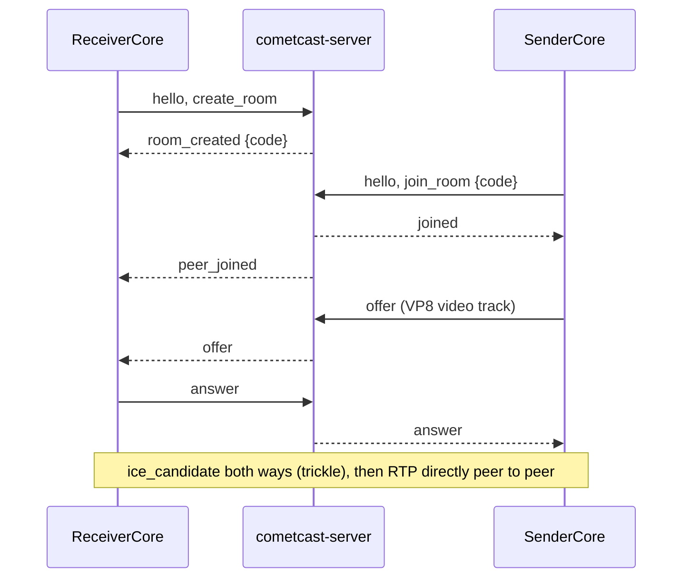

# Native transport (M1, native side)

This page describes the Rust path that speaks the signalling protocol of
[protocol.md](protocol.md) and interoperates with the browser web app. It exists to test
the Rust core's WebRTC path (assumptions A1/A2, measurement point 2 in
[measurement-points.md](measurement-points.md)). It is a first slice, not the finished transport.

## Pieces

| Where | What |
| --- | --- |
| `crates/cc-transport` | `SignalingClient` (WebSocket, `cc-proto` message types, plain or TLS), `net` (server address parsing, TLS trust, a minimal HTTP GET), `altcha` (proof-of-work solver), `ice` (`/ice-servers` client), `Session` (wrapper over the `webrtc` crate), `Route`, RTP counters and key frame check |
| `crates/cc-files` | Content over the control data channel: message set (web format plus `document`), sender chunking, receiver state machine with hard limits, PDF hand-over to `cc-docs` (see below) |
| `crates/cc-receiver` | `ReceiverCore`: creates a room (solves ALTCHA when the server asks), exposes the code, answers the offer, reports video through events |
| `crates/cc-sender` | `SenderCore`: joins by code, offers, sends a synthetic VP8 stream, or the real screen as H.264 (see [capture.md](capture.md)) |
| `bins/cometcast-cli` | `receive`, `send`, `send-file` and `send-link` commands (developer tool, English output only) |
| `tools/gen-test-frames.py` | Dev-time script that made `crates/cc-sender/assets/test-frames.ivf` |

## WebRTC library

`webrtc` **0.21.1** (webrtc-rs, MIT / Apache-2.0) exists on crates.io and builds in this
environment (Rust 1.97, Linux) with its default features (`runtime-tokio`, `crypto-ring`); a
clean `cargo build -p cc-transport` took about 40 s. Version 0.21 is a rewrite on top of the sans-io
`rtc` crates, so its API differs from older 0.x versions and from most online examples. We also name
`rtc` 0.21.1 directly because media types (codecs, RTCP) live there; keep both on the same version.
UNCERTAIN: the minimum Rust version of these crates is not checked; the workspace `rust-version` (1.92) is
still not measured with exactly that toolchain and CI uses the stable toolchain.

`cc-proto` is unchanged and still has no heavy dependencies (`cargo check -p cc-proto --target wasm32-unknown-unknown` passes).

## Flow



The sender creates the offer after `joined`, as in the web app. Candidates travel as the JSON text of
an `RTCIceCandidateInit` (no protocol change; see protocol.md).

## Codecs

- Receiver: registers the library's default codecs, so it can answer what a browser offers
  (by reading the library source: VP8, VP9, H.264 in several profiles, AV1 and H.265; only VP8 was observed in the tests, so the others are untested).
- Sender: registers VP8 only (payload type 96) in test pattern mode, or H.264 only (`packetization-mode=1`, `profile-level-id=42e01f`, payload type 102) in screen mode; see [capture.md](capture.md).
- Reported by the receiver: packets, payload bytes, frames (RTP marker bit) and key frames.
  Key frame detection is a quick check of payload headers for VP8 and H.264 (unit tested), a rough check for VP9, and
  not available for AV1. There is no decoding or rendering.

## Synthetic sender

There is no encoder (GPL encoders are excluded). The sender replays 12 VP8 key frames (320x180, 15 fps,
about 5 KB in total) from `crates/cc-sender/assets/test-frames.ivf`. Every frame is a key frame; that is valid VP8 and
Chromium decodes it, but it is not how a real encoder behaves. The file was generated once by
`tools/gen-test-frames.py` (Pillow's bundled libwebp (Pillow 12.3.0, libwebp 1.6.0) writes lossy WebP files whose `VP8 ` chunk is a VP8 key frame;
the script copies those chunks into IVF). Nothing at build or test time needs Python, ffmpeg or libwebp.
It is a dev-time tool whose output is committed. The frames contain only rectangles (no text, so no font), see THIRD_PARTY_NOTICES.md.

## Commands

```sh
cargo run -p cometcast-server -- --listen 127.0.0.1:8443
cargo run -p cometcast-cli -- receive [--server ADDRESS] [--bind ADDR] [--ca-file PEM]
cargo run -p cometcast-cli -- send <CODE> [--server ADDRESS] [--seconds N] [--bind ADDR] [--ca-file PEM]
cargo run -p cometcast-cli -- send <CODE> --screen [--display :99] [--fps 15] [--bitrate-kbps 2000]
cargo run -p cometcast-cli -- receive --decode   # also decodes H.264 and prints size and mean colour
cargo run -p cometcast-cli -- send-file <CODE> photo.png            # or a .pdf; --then next,go:3,stop sends page commands
cargo run -p cometcast-cli -- send-link <CODE> https://example.org/
```

`ADDRESS` is `HOST:PORT` (plain `ws://`) or a `ws://`, `wss://`, `http://` or `https://` URL.
`--ca-file` trusts the certificate(s) in a PEM file in addition to the system store (for the self-signed
certificate of a development server, `tls.self_signed_cert_out` in [server.md](server.md)).

`receive` prints `Room code: XXXXXX`, then one line per second such as
`stats packets=203 bytes=198354 frames=77 keyframes=2 (+61 packets/s)`. It exits with 0 when the sender
leaves or on Ctrl-C. Exit codes: 0 ok, 1 error, 2 bad arguments, 3 the peer left before any video was exchanged. The default server is `127.0.0.1:8443`. `--bind` sets the local UDP address; the default
`0.0.0.0:0` makes the library bind one socket per non-loopback interface.

## Content over the control data channel

The sender creates a data channel `control` (ordered, reliable) before the offer, as the web client does; the
receiver accepts the first channel with that label and closes others. Message format and limits: [web-m2.md](web-m2.md)
(JSON text messages `image` / `image_end` / `link` / `cmd`, 16 KiB binary chunks, plus the native `document` /
`document_end` kinds for PDFs). It works with a media stream or alone (content-only offer without media sections).

| Layer | What |
| --- | --- |
| `cc-transport`: `Session::create_control_channel`, `SessionEvent::ControlChannel`, `ControlChannel` | the channel; incoming messages through a queue bounded by **count** (64 messages, each up to the SCTP maximum; the size rules are checked by `cc-files`: 32 KiB for text, exactly 16 KiB for chunks, and every stray or malformed message counts as a violation there); sending waits when more than 1 MiB is queued (`with_data_channel_send_buffer_limit`), thresholds 256 KiB / 1 MiB as the web client; `flush`, `close_graceful` |
| `cc-files` | `wire` (parse and validate every message, link rules like the web client's `validateLinkUrl`), `outgoing` (chunking), `receiver::ContentReceiver` (state machine) |
| `cc-sender` | `ContentSender` (content-only sender), `ControlSender` (`send_image`, `send_document`, `send_link`, `send_cmd`, `finish`), `SenderOptions::control` for a channel next to video |
| `cc-receiver` | `ReceiverOptions::content` turns it on; events come from `ReceiverCore::take_content_events()`: `TransferStarted`, `ImageReceived`, `LinkRequested`, `DocumentOpened`, `PageRendered`, `ContentStopped`, `Error`; `set_content_target_width` |

Receiver rules (each has a unit test in `crates/cc-files`, several also in `crates/cc-receiver/tests/content.rs`):

- One transfer at a time. The buffer is reserved once at the announced size, which is checked against the limit first (images
  10 MiB, PDFs 64 MiB and `cc-docs`' own file limit); data past the announced size ends the transfer.
- Every chunk is exactly 16 KiB except the last, so messages are bounded by size / 16 KiB (tiny-chunk floods are refused);
  chunks without a transfer, an end message of the wrong kind, a size mismatch and a transfer that interrupts another one
  are protocol violations (reported; a flood of unexpected chunks gives one event; each stray chunk counts). After 64
  violations the receiver blocks itself and closes the channel. Violations **decay**: one is forgotten per 2 s, so rare
  slips in a long session do not add up, while a flood does. A **refused** transfer start (too large, type not allowed;
  a refused `document` is reported as `DocumentRejected` and the shown document is closed) is one violation, and the
  data of that transfer is swallowed silently up to the announced size (at most 1 GiB; a larger announcement is not
  believed) and its end message; any other text message ends the skipping. An honest 8 MiB PDF sent to a receiver
  that takes 1 MiB therefore costs one violation, not 513.
- Links are validated again (http/https, no credentials, at most 2048 characters as written and as normalised, no control
  characters, WHATWG parsing through the `url` crate, idempotent) and reported as `LinkRequested`; **never opened by the core**.
- A PDF goes to `cc_docs::Document::open_with_options` (child process with memory and time limits, `Isolation::Auto` or the
  application's choice) and a page is rendered only after its size was checked against the output limits (scaled down to
  fit when it would be too large). Page numbers are clamped by `DocumentSession`. Every failure is an `Error` event; a
  document that cannot be opened is also a violation, and opens are rate limited (burst of 5, one more per 3 s), because
  each costs a child process. A new document always closes the old one first (nothing stale stays shown).
- Page commands do not render by themselves. The content task reads everything that is queued, so a flood of
  `next_page` / `prev_page` / `go_to_page` costs **one** render of the last page asked for (tested: 1000 commands, a
  handful of renders). Renders keep at least 100 ms between their starts. `stop`, a new document and a new image cancel a
  running render at once (the cc-docs cancel flag kills the child process); a newer page cancels a render that already ran
  for more than 1 s, a faster one is allowed to finish and its picture is still delivered. Opening a document cannot be
  interrupted (up to the open time limit of `cc-docs`, 10 s by default); its result is dropped if `stop` came in the
  meantime. A panic in the blocking thread does not reset the receiver: violations and the blocked state stay.
  UNCERTAIN: 100 ms, 1 s and the open budget are placeholders, unmeasured; the in-process engine (tests, no worker)
  cannot interrupt a render.
- A transfer that receives nothing for 60 s is dropped with a `transfer_timeout` event (not a violation).
- Memory on the receiving side is bounded: library queue (256 messages), inbox (64 messages, up to the SCTP maximum each),
  event queue (see below), one transfer buffer (at most 64 MiB for a PDF, 10 MiB for an image), the document waiting to open
  and the opened one (about 64 MiB each; the render child holds its own copy), and one page being rendered (at most the
  output limit of `cc-docs`, 7680 x 4320 x 4 = about 127 MiB). The event queue is bounded by **count (16) and by bytes
  (32 MiB of pictures)**; a single event is always admitted into an empty queue, and a `PageRendered` that is still queued
  when a newer one arrives is dropped. So pages cannot pile up: the queue holds at most 32 MiB, or one event if that is
  larger. Worst case at the default limits, roughly: 64 (transfer) + 64 + 64 (document) + 127 (render) + 127 (queued
  page) = about 450 MiB plus the application's own copy of what it shows. UNCERTAIN: computed from the limits, not
  measured. Tested: 48 images of 1 MiB to a reader that does not read; the byte bound of the queue in
  `crates/cc-receiver/src/content.rs`.
- `ContentSender` closes the data channel before the connection (the close is ordered after the data), so the browser
  delivers the last messages first; closing the connection at once lost the end of a transfer in about half of the runs
  against Chromium. `send-file` also stays connected until Ctrl-C (or `--seconds N`) because a web receiver drops the
  shown content when the sender leaves.

**Integrators:** read `ReceiverCore::take_content_events()` **while** you read `next_event()` (one `select!`, content
first; the CLI does), because the content task is slowed down by a full queue and `PeerLeft` is only emitted after the
content that was on its way had a chance (at most 5 s) to be handed over. After `PeerLeft`, read the content stream until
it returns `None` before you exit or drop the core; otherwise the last events (for example the final page) are lost.
`cometcast-cli receive` does this. The tests of `crates/cc-receiver/tests/content.rs` render in the `cc-docs-worker` child
process and **fail** when it is missing or broken (run `cargo build --workspace --bins` first); set
`COMETCAST_ALLOW_INPROCESS_RENDER=1` to allow the in-process fallback on purpose.

UNCERTAIN: the limits (64 MiB documents, 64 violations, queue sizes, thresholds) are guesses, not measured. The 60 s
timeout of a stalled transfer is a placeholder. Magic bytes of images
are not checked (the web client does not either); the declared type only decides how the application shows the bytes.
Throughput of the data channel was not measured. Only Chromium was tested against the native peers.

## Open servers, TLS and TURN (native side)

- **ALTCHA.** `ReceiverCore::start` sends `create_room` without a payload. If the server answers `altcha_required`
  (open mode always does), it fetches `GET /altcha/challenge` over HTTP(S), solves it with the `altcha` crate's
  `solve_challenge` (on a blocking thread, 30 s give-up time, UNCERTAIN: placeholder, solving time on weak devices is
  not measured, measurement point 8) and sends `create_room` again with the `altcha` field on the same connection.
  `altcha_invalid`, `rate_limited` and `banned` arrive as `TransportError::Server { code, .. }`; refusals of the HTTP
  request (429, 403, 503) use the same codes (`rate_limited`, `banned` or `forbidden`, `server_full`). The sender needs
  no puzzle (`join_room`).
- **Limits on server data.** The server is not trusted to be harmless. Before solving, the native client (and the web app
  with the same limits) refuses a puzzle whose `cost` is above 10 000 (10 times the server default of 1000), whose
  `keyLength` is above 64 bytes, whose `keyPrefix` is longer than the key, that uses memory-hard parameters, or whose
  `expiresAt` has passed (UNCERTAIN: 10 000 and 64 are placeholders; the server itself has no maximum for the cost, so an
  operator who sets a higher one locks native and web clients out). The `altcha` crate checks its timeout every 10
  attempts, so the real limit is the give-up time plus 10 attempts at the maximum cost (well below a second); the
  blocking thread cannot be cancelled and lives at most that long. The web app maps these refusals to the error codes
  `altcha_too_hard` and `altcha_expired`, and gives up on the `/altcha/challenge` request after 8 s (UNCERTAIN:
  placeholder). HTTP answers are parsed strictly: duplicate or non-numeric `Content-Length`, `Content-Length` together
  with `Transfer-Encoding`, unknown transfer codings, bodies longer than declared and chunk sizes that are not plain
  hex are errors; the decoded body is capped at 256 KiB. The `/ice-servers` list is cut to 16 entries with at most 8
  URLs each (UNCERTAIN: placeholders), URLs must start with `stun:`, `stuns:`, `turn:` or `turns:`, and the debug output
  of `IceServerConfig` hides the credential.
- **STUN/TURN.** If `SessionConfig::ice_servers` is empty, both cores fetch `GET /ice-servers` before building the WebRTC
  session and pass the list to the library (`RTCConfiguration.ice_servers`). `404` or any failure means no list.
  `ReceiverCore::ice_servers()` / `SenderCore::ice_servers()` report what is used; the CLI prints one line
  `ICE servers from the server: N (M with TURN credentials)`. Entries with a `turn:` URL but no credentials are dropped.
  UNCERTAIN: only the configuration path is tested (the library accepts the list; the server hands out the right
  credentials). No media was relayed through a real coturn.
- **TLS.** `wss://` and `https://` work: `cc-transport` opens the TCP connection itself, does the TLS handshake with
  rustls (`ring` backend, same as the server) using the system trust store (`rustls-native-certs`) plus optional extra
  certificates (`TlsTrust::add_pem`, CLI `--ca-file`), and hands the stream to the WebSocket code. UNCERTAIN: the system
  store is empty or unreadable on some platforms (for example Android); there only extra certificates would work, and
  a build for those platforms was not tried. The small HTTP client (`net::http_get`) is hand-written (HTTP/1.1,
  `Connection: close`, content-length and chunked bodies, 256 KiB cap) because only two tiny JSON endpoints are needed;
  it does not follow redirects and does not use proxy settings.

## Tests and what they prove

| Test | Command | Proves |
| --- | --- | --- |
| Rust loopback | `cargo test -p cc-receiver --test loopback` | Real `cc-server` on an ephemeral port in the same process, `ReceiverCore` and `SenderCore` over real UDP on 127.0.0.1: at least 20 RTP packets, frames and VP8 key frames counted; `PeerLeft` after the sender stops; wrong code gives `room_not_found` |
| Open mode, TLS, TURN list | `cargo test -p cc-receiver --test open_mode` | Real `cc-server` in open mode: `create_room` without ALTCHA is refused, with an invalid payload `altcha_invalid`; `ReceiverCore` solves the puzzle by itself and video flows (real UDP on 127.0.0.1); a solved puzzle cannot be used twice; `wss://` and `https://` against a self-signed server (refused without its certificate, works with it); an internal-mode server with a TURN secret hands out a list whose credential matches HMAC-SHA1, and both cores report it |
| Solver, address parsing, HTTP parsing | `cargo test -p cc-transport` | A challenge made by the `altcha` crate (`crates/cc-transport/testdata/altcha-known.json`, also solved by the web test) is solved and verified; address forms; HTTP answers (content-length, chunked, partial); ICE list parsing; TURN configuration accepted by the library |
| Content, native to native | `cargo test -p cc-receiver --test content` | Real `cc-server` and UDP on 127.0.0.1: image (byte for byte), link, PDF (3 pages, rendered at the target width in the `cc-docs` child process when `cc-docs-worker` is found, else in process), next/prev/go-to page, stop, a refused PDF, 48 MiB through a reader that does not read (back-pressure), a hostile sender (oversize announcement, junk, chunk flood: errors, then cut off), a channel next to video, a receiver without content that refuses the channel |
| Content, state machine | `cargo test -p cc-files` | Chunking, reassembly, limits, hostile sequences (oversize, tiny chunks, chunk after end, interleaved transfers, truncated, wrong MIME and type, link rules, command edge cases, PDF handling) |
| Content, browser and Rust | `cd apps/web && npm run build:wasm && npm run build && npm run e2e:content` | Web content sender to `cometcast-cli receive` (image byte for byte, link printed and not opened, a PDF opened with 3 pages and a page turn, stop); `cometcast-cli send-file` to the web receiver (`` `naturalWidth > 0`), `send-link` (link card), PDF (rendered into a non-blank canvas, en and de; without `build:wasm` the translated "cannot show documents yet" notice instead); `send-file x.pdf --then next,go:3,prev,stop` to `receive` (pages 1, 2, 3, 2, stopped, with the sandboxed worker) |
| Browser to Rust, Rust to browser | `cd apps/web && npm run build && npm run e2e:native` | Chromium web sender to `cometcast-cli receive` (packet counts rise every second) and `cometcast-cli send` to the web receiver (Chromium decodes the Rust VP8 stream at 320x180 and plays it) |

Observed once in this environment (not a benchmark): browser to Rust, about 60 packets/s, VP8, 2 key frames in the
first seconds (the Rust receiver sends a picture-loss request at the start).

## Limits and open points

- **Direct route only as a route.** `Route::ServerRelay` and `Route::ReceiverWifi` are not implemented; `Session::new`
  rejects them. STUN/TURN servers from the signalling server are passed to the library (see above), but no relay path
  was tested. UNCERTAIN: how often direct works in office or campus networks is measurement point 1 / milestone M8.
- **Same-machine or same-LAN tests only.** Everything was run on one machine (loopback and the machine's own interface
  address). Nothing was measured across NAT, on lossy Wi-Fi, or with a second device. Latency, CPU and quality (measurement point 2) are **not measured**.
- Chromium was started with `--disable-features=WebRtcHideLocalIpsWithMdns`; the Rust side cannot resolve `.local`
  mDNS candidate names, so with default Chromium settings across machines the connection may fail. UNCERTAIN: not tested.
- Only Chromium was tested. Firefox and Safari are untested against the native peers.
- One video m-line, no audio. The `control` data channel exists (see above); the signalling `control` messages of protocol.md are still ignored by the cores.
- One sender per `ReceiverCore`: after `peer_left` the core stops. A new sender needs a new core (and a new room code).
- Candidates: native clients leave `sdpMid` out (`null`) and set `sdpMLineIndex` to 0. With media plus data channel, or a data channel alone, everything is in one BUNDLE group and this worked against Chromium; other browsers are untested.
- Server addresses accepted: `host:port`, `host:port/ws`, `ws://...`, `wss://...`, `http://...` (read as `ws://`), `https://...` (read as `wss://`).
- Disconnected state: the library may report `Disconnected` and recover; both cores treat `Failed` and signalling loss as final, `Disconnected` is not.
  The receiver also gives up (error event) if no connection exists 30 s after the offer arrived (UNCERTAIN: placeholder value). The sender has no such timeout yet.
  UNCERTAIN: no reconnect or ICE restart logic.
- The frame counter assumes one RTP marker per frame.
- Dropping a `ReceiverCore` or `SenderCore` without calling `stop()` asks its background task to finish, which closes the WebRTC session and the signalling connection; `stop()` additionally waits for that.
