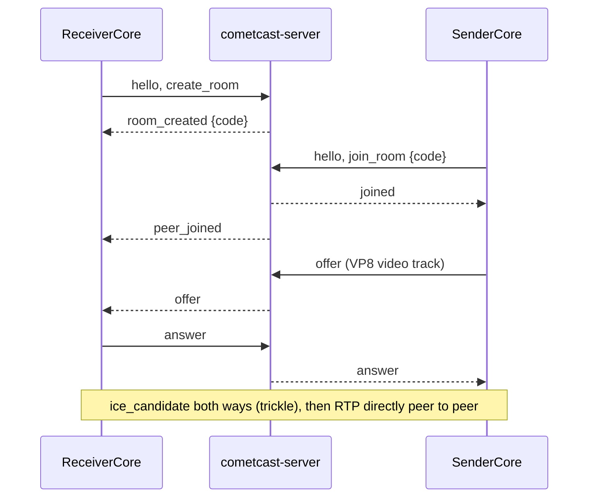

# Native transport (M1, native side)

This page describes the Rust path that speaks the signalling protocol of
[protocol.md](protocol.md) and interoperates with the browser web app. It exists to test
the Rust core's WebRTC path (assumptions A1/A2, measurement point 2 in
[measurement-points.md](measurement-points.md)). It is a first slice, not the finished transport.

## Pieces

| Where | What |
| --- | --- |
| `crates/cc-transport` | `SignalingClient` (WebSocket, `cc-proto` message types), `Session` (wrapper over the `webrtc` crate), `Route`, RTP counters and key frame check |
| `crates/cc-receiver` | `ReceiverCore`: creates a room, exposes the code, answers the offer, reports video through events |
| `crates/cc-sender` | `SenderCore`: joins by code, offers, sends a synthetic VP8 stream |
| `bins/cometcast-cli` | `receive` and `send` commands (developer tool, English output only) |
| `tools/gen-test-frames.py` | Dev-time script that made `crates/cc-sender/assets/test-frames.ivf` |

## WebRTC library

`webrtc` **0.21.1** (webrtc-rs, MIT / Apache-2.0) exists on crates.io and builds in this
environment (Rust 1.97, Linux) with its default features (`runtime-tokio`, `crypto-ring`); a
clean `cargo build -p cc-transport` took about 40 s. Version 0.21 is a rewrite on top of the sans-io
`rtc` crates, so its API differs from older 0.x versions and from most online examples. We also name
`rtc` 0.21.1 directly because media types (codecs, RTCP) live there; keep both on the same version.
UNCERTAIN: the minimum Rust version of these crates is not checked; the workspace `rust-version` (1.85) is
still a placeholder and CI uses the stable toolchain.

`cc-proto` is unchanged and still has no heavy dependencies (`cargo check -p cc-proto --target wasm32-unknown-unknown` passes).

## Flow



The sender creates the offer after `joined`, as in the web app. Candidates travel as the JSON text of
an `RTCIceCandidateInit` (no protocol change; see protocol.md).

## Codecs

- Receiver: registers the library's default codecs, so it can answer what a browser offers
  (by reading the library source: VP8, VP9, H.264 in several profiles, AV1 and H.265; only VP8 was observed in the tests, so the others are untested).
- Sender: registers VP8 only, payload type 96.
- Reported by the receiver: packets, payload bytes, frames (RTP marker bit) and key frames.
  Key frame detection is a quick check of payload headers for VP8 and H.264 (unit tested), a rough check for VP9, and
  not available for AV1. There is no decoding or rendering.

## Synthetic sender

There is no encoder (GPL encoders are excluded). The sender replays 12 VP8 key frames (320x180, 15 fps,
about 9 KB in total) from `crates/cc-sender/assets/test-frames.ivf`. Every frame is a key frame; that is valid VP8 and
Chromium decodes it, but it is not how a real encoder behaves. The file was generated once by
`tools/gen-test-frames.py` (Pillow's libwebp writes lossy WebP files whose `VP8 ` chunk is a VP8 key frame;
the script copies those chunks into IVF). Nothing at build or test time needs Python, ffmpeg or libwebp.
It is a dev-time tool whose output is committed.

## Commands

```sh
cargo run -p cometcast-server -- --listen 127.0.0.1:8443
cargo run -p cometcast-cli -- receive [--server HOST:PORT] [--bind ADDR]
cargo run -p cometcast-cli -- send <CODE> [--server HOST:PORT] [--seconds N] [--bind ADDR]
```

`receive` prints `Room code: XXXXXX`, then one line per second such as
`stats packets=203 bytes=198354 frames=77 keyframes=2 (+61 packets/s)`. It exits with 0 when the sender
leaves or on Ctrl-C. The default server is `127.0.0.1:8443`. `--bind` sets the local UDP address; the default
`0.0.0.0:0` makes the library bind one socket per non-loopback interface.

## Tests and what they prove

| Test | Command | Proves |
| --- | --- | --- |
| Rust loopback | `cargo test -p cc-receiver --test loopback` | Real `cc-server` on an ephemeral port in the same process, `ReceiverCore` and `SenderCore` over real UDP on 127.0.0.1: at least 20 RTP packets, frames and VP8 key frames counted; `PeerLeft` after the sender stops; wrong code gives `room_not_found` |
| Browser to Rust, Rust to browser | `cd apps/web && npm run build && npm run e2e:native` | Chromium web sender to `cometcast-cli receive` (packet counts rise every second) and `cometcast-cli send` to the web receiver (Chromium decodes the Rust VP8 stream at 320x180 and plays it) |

Observed once in this environment (not a benchmark): browser to Rust, about 60 packets/s, VP8, 2 key frames in the
first seconds (the Rust receiver sends a picture-loss request at the start).

## Limits and open points

- **Direct route only.** No STUN, no TURN, no relay. `Route::ServerRelay` and `Route::ReceiverWifi` are not implemented;
  `Session::new` rejects them. UNCERTAIN: how often direct works in school or office networks is measurement point 1 / milestone M8.
- **Same-machine or same-LAN tests only.** Everything was run on one machine (loopback and the machine's own interface
  address). Nothing was measured across NAT, on lossy Wi-Fi, or with a second device. Latency, CPU and quality (measurement point 2) are **not measured**.
- Chromium was started with `--disable-features=WebRtcHideLocalIpsWithMdns`; the Rust side cannot resolve `.local`
  mDNS candidate names, so with default Chromium settings across machines the connection may fail. UNCERTAIN: not tested.
- Only Chromium was tested. Firefox and Safari are untested against the native peers.
- One video m-line, no audio, no data channel, no control messages handled yet (the `control` messages are ignored by the cores).
- One sender per `ReceiverCore`: after `peer_left` the core stops. A new sender needs a new core (and a new room code).
- Candidates: native clients send `sdpMid` empty and `sdpMLineIndex` 0, which works for one bundled video line only.
- No TLS on the signalling connection yet (plain `ws://`).
- Disconnected state: the library may report `Disconnected` and recover; the cores only treat `Failed` and signalling loss as final.
  UNCERTAIN: no reconnect or ICE restart logic.
- The frame counter assumes one RTP marker per frame.
