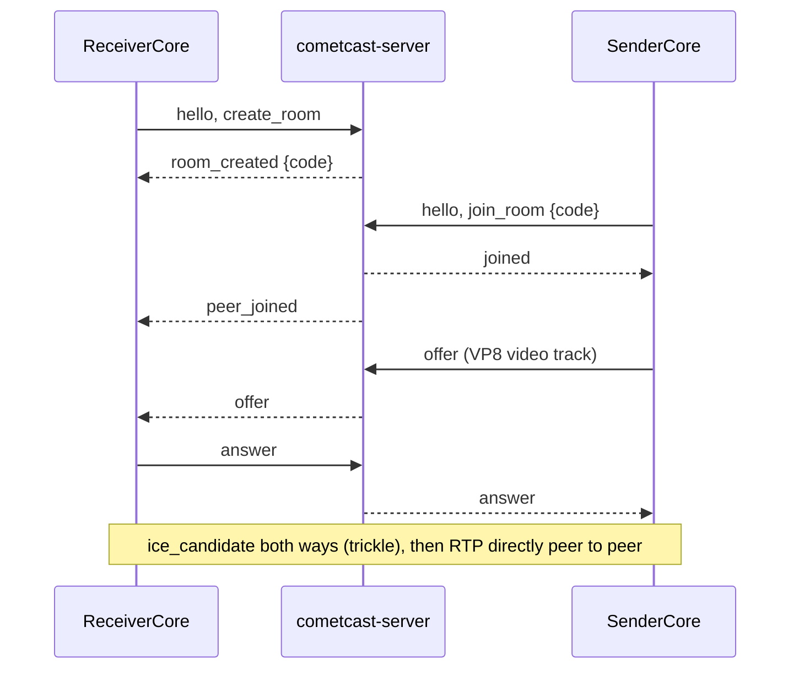

# Native transport (M1, native side)

This page describes the Rust path that speaks the signalling protocol of
[protocol.md](protocol.md) and interoperates with the browser web app. It exists to test
the Rust core's WebRTC path (assumptions A1/A2, measurement point 2 in
[measurement-points.md](measurement-points.md)). It is a first slice, not the finished transport.

## Pieces

| Where | What |
| --- | --- |
| `crates/cc-transport` | `SignalingClient` (WebSocket, `cc-proto` message types, plain or TLS), `net` (server address parsing, TLS trust, a minimal HTTP GET), `altcha` (proof-of-work solver), `ice` (`/ice-servers` client), `Session` (wrapper over the `webrtc` crate), `Route`, RTP counters and key frame check |
| `crates/cc-receiver` | `ReceiverCore`: creates a room (solves ALTCHA when the server asks), exposes the code, answers the offer, reports video through events |
| `crates/cc-sender` | `SenderCore`: joins by code, offers, sends a synthetic VP8 stream |
| `bins/cometcast-cli` | `receive` and `send` commands (developer tool, English output only) |
| `tools/gen-test-frames.py` | Dev-time script that made `crates/cc-sender/assets/test-frames.ivf` |

## WebRTC library

`webrtc` **0.21.1** (webrtc-rs, MIT / Apache-2.0) exists on crates.io and builds in this
environment (Rust 1.97, Linux) with its default features (`runtime-tokio`, `crypto-ring`); a
clean `cargo build -p cc-transport` took about 40 s. Version 0.21 is a rewrite on top of the sans-io
`rtc` crates, so its API differs from older 0.x versions and from most online examples. We also name
`rtc` 0.21.1 directly because media types (codecs, RTCP) live there; keep both on the same version.
UNCERTAIN: the minimum Rust version of these crates is not checked; the workspace `rust-version` (1.85) is
still a placeholder and CI uses the stable toolchain.

`cc-proto` is unchanged and still has no heavy dependencies (`cargo check -p cc-proto --target wasm32-unknown-unknown` passes).

## Flow



The sender creates the offer after `joined`, as in the web app. Candidates travel as the JSON text of
an `RTCIceCandidateInit` (no protocol change; see protocol.md).

## Codecs

- Receiver: registers the library's default codecs, so it can answer what a browser offers
  (by reading the library source: VP8, VP9, H.264 in several profiles, AV1 and H.265; only VP8 was observed in the tests, so the others are untested).
- Sender: registers VP8 only, payload type 96.
- Reported by the receiver: packets, payload bytes, frames (RTP marker bit) and key frames.
  Key frame detection is a quick check of payload headers for VP8 and H.264 (unit tested), a rough check for VP9, and
  not available for AV1. There is no decoding or rendering.

## Synthetic sender

There is no encoder (GPL encoders are excluded). The sender replays 12 VP8 key frames (320x180, 15 fps,
about 5 KB in total) from `crates/cc-sender/assets/test-frames.ivf`. Every frame is a key frame; that is valid VP8 and
Chromium decodes it, but it is not how a real encoder behaves. The file was generated once by
`tools/gen-test-frames.py` (Pillow's bundled libwebp (Pillow 12.3.0, libwebp 1.6.0) writes lossy WebP files whose `VP8 ` chunk is a VP8 key frame;
the script copies those chunks into IVF). Nothing at build or test time needs Python, ffmpeg or libwebp.
It is a dev-time tool whose output is committed. The frames contain only rectangles (no text, so no font), see THIRD_PARTY_NOTICES.md.

## Commands

```sh
cargo run -p cometcast-server -- --listen 127.0.0.1:8443
cargo run -p cometcast-cli -- receive [--server ADDRESS] [--bind ADDR] [--ca-file PEM]
cargo run -p cometcast-cli -- send <CODE> [--server ADDRESS] [--seconds N] [--bind ADDR] [--ca-file PEM]
```

`ADDRESS` is `HOST:PORT` (plain `ws://`) or a `ws://`, `wss://`, `http://` or `https://` URL.
`--ca-file` trusts the certificate(s) in a PEM file in addition to the system store (for the self-signed
certificate of a development server, `tls.self_signed_cert_out` in [server.md](server.md)).

`receive` prints `Room code: XXXXXX`, then one line per second such as
`stats packets=203 bytes=198354 frames=77 keyframes=2 (+61 packets/s)`. It exits with 0 when the sender
leaves or on Ctrl-C. Exit codes: 0 ok, 1 error, 2 bad arguments, 3 the peer left before any video was exchanged. The default server is `127.0.0.1:8443`. `--bind` sets the local UDP address; the default
`0.0.0.0:0` makes the library bind one socket per non-loopback interface.

## Open servers, TLS and TURN (native side)

- **ALTCHA.** `ReceiverCore::start` sends `create_room` without a payload. If the server answers `altcha_required`
  (open mode always does), it fetches `GET /altcha/challenge` over HTTP(S), solves it with the `altcha` crate's
  `solve_challenge` (on a blocking thread, 30 s give-up time, UNCERTAIN: placeholder, solving time on weak devices is
  not measured, measurement point 8) and sends `create_room` again with the `altcha` field on the same connection.
  `altcha_invalid`, `rate_limited` and `banned` arrive as `TransportError::Server { code, .. }`; refusals of the HTTP
  request (429, 403, 503) use the same codes (`rate_limited`, `banned` or `forbidden`, `server_full`). The sender needs
  no puzzle (`join_room`).
- **Limits on server data.** The server is not trusted to be harmless. Before solving, the native client (and the web app
  with the same limits) refuses a puzzle whose `cost` is above 10 000 (10 times the server default of 1000), whose
  `keyLength` is above 64 bytes, whose `keyPrefix` is longer than the key, that uses memory-hard parameters, or whose
  `expiresAt` has passed (UNCERTAIN: 10 000 and 64 are placeholders; the server itself has no maximum for the cost, so an
  operator who sets a higher one locks native and web clients out). The `altcha` crate checks its timeout every 10
  attempts, so the real limit is the give-up time plus 10 attempts at the maximum cost (well below a second); the
  blocking thread cannot be cancelled and lives at most that long. The web app maps these refusals to the error codes
  `altcha_too_hard` and `altcha_expired`, and gives up on the `/altcha/challenge` request after 8 s (UNCERTAIN:
  placeholder). HTTP answers are parsed strictly: duplicate or non-numeric `Content-Length`, `Content-Length` together
  with `Transfer-Encoding`, unknown transfer codings, bodies longer than declared and chunk sizes that are not plain
  hex are errors; the decoded body is capped at 256 KiB. The `/ice-servers` list is cut to 16 entries with at most 8
  URLs each (UNCERTAIN: placeholders), URLs must start with `stun:`, `stuns:`, `turn:` or `turns:`, and the debug output
  of `IceServerConfig` hides the credential.
- **STUN/TURN.** If `SessionConfig::ice_servers` is empty, both cores fetch `GET /ice-servers` before building the WebRTC
  session and pass the list to the library (`RTCConfiguration.ice_servers`). `404` or any failure means no list.
  `ReceiverCore::ice_servers()` / `SenderCore::ice_servers()` report what is used; the CLI prints one line
  `ICE servers from the server: N (M with TURN credentials)`. Entries with a `turn:` URL but no credentials are dropped.
  UNCERTAIN: only the configuration path is tested (the library accepts the list; the server hands out the right
  credentials). No media was relayed through a real coturn.
- **TLS.** `wss://` and `https://` work: `cc-transport` opens the TCP connection itself, does the TLS handshake with
  rustls (`ring` backend, same as the server) using the system trust store (`rustls-native-certs`) plus optional extra
  certificates (`TlsTrust::add_pem`, CLI `--ca-file`), and hands the stream to the WebSocket code. UNCERTAIN: the system
  store is empty or unreadable on some platforms (for example Android); there only extra certificates would work, and
  a build for those platforms was not tried. The small HTTP client (`net::http_get`) is hand-written (HTTP/1.1,
  `Connection: close`, content-length and chunked bodies, 256 KiB cap) because only two tiny JSON endpoints are needed;
  it does not follow redirects and does not use proxy settings.

## Tests and what they prove

| Test | Command | Proves |
| --- | --- | --- |
| Rust loopback | `cargo test -p cc-receiver --test loopback` | Real `cc-server` on an ephemeral port in the same process, `ReceiverCore` and `SenderCore` over real UDP on 127.0.0.1: at least 20 RTP packets, frames and VP8 key frames counted; `PeerLeft` after the sender stops; wrong code gives `room_not_found` |
| Open mode, TLS, TURN list | `cargo test -p cc-receiver --test open_mode` | Real `cc-server` in open mode: `create_room` without ALTCHA is refused, with an invalid payload `altcha_invalid`; `ReceiverCore` solves the puzzle by itself and video flows (real UDP on 127.0.0.1); a solved puzzle cannot be used twice; `wss://` and `https://` against a self-signed server (refused without its certificate, works with it); an internal-mode server with a TURN secret hands out a list whose credential matches HMAC-SHA1, and both cores report it |
| Solver, address parsing, HTTP parsing | `cargo test -p cc-transport` | A challenge made by the `altcha` crate (`crates/cc-transport/testdata/altcha-known.json`, also solved by the web test) is solved and verified; address forms; HTTP answers (content-length, chunked, partial); ICE list parsing; TURN configuration accepted by the library |
| Browser to Rust, Rust to browser | `cd apps/web && npm run build && npm run e2e:native` | Chromium web sender to `cometcast-cli receive` (packet counts rise every second) and `cometcast-cli send` to the web receiver (Chromium decodes the Rust VP8 stream at 320x180 and plays it) |

Observed once in this environment (not a benchmark): browser to Rust, about 60 packets/s, VP8, 2 key frames in the
first seconds (the Rust receiver sends a picture-loss request at the start).

## Limits and open points

- **Direct route only as a route.** `Route::ServerRelay` and `Route::ReceiverWifi` are not implemented; `Session::new`
  rejects them. STUN/TURN servers from the signalling server are passed to the library (see above), but no relay path
  was tested. UNCERTAIN: how often direct works in school or office networks is measurement point 1 / milestone M8.
- **Same-machine or same-LAN tests only.** Everything was run on one machine (loopback and the machine's own interface
  address). Nothing was measured across NAT, on lossy Wi-Fi, or with a second device. Latency, CPU and quality (measurement point 2) are **not measured**.
- Chromium was started with `--disable-features=WebRtcHideLocalIpsWithMdns`; the Rust side cannot resolve `.local`
  mDNS candidate names, so with default Chromium settings across machines the connection may fail. UNCERTAIN: not tested.
- Only Chromium was tested. Firefox and Safari are untested against the native peers.
- One video m-line, no audio, no data channel, no control messages handled yet (the `control` messages are ignored by the cores).
- One sender per `ReceiverCore`: after `peer_left` the core stops. A new sender needs a new core (and a new room code).
- Candidates: native clients leave `sdpMid` out (`null`) and set `sdpMLineIndex` to 0, which works for one bundled video line only.
- Server addresses accepted: `host:port`, `host:port/ws`, `ws://...`, `wss://...`, `http://...` (read as `ws://`), `https://...` (read as `wss://`).
- Disconnected state: the library may report `Disconnected` and recover; both cores treat `Failed` and signalling loss as final, `Disconnected` is not.
  The receiver also gives up (error event) if no connection exists 30 s after the offer arrived (UNCERTAIN: placeholder value). The sender has no such timeout yet.
  UNCERTAIN: no reconnect or ICE restart logic.
- The frame counter assumes one RTP marker per frame.
- Dropping a `ReceiverCore` or `SenderCore` without calling `stop()` asks its background task to finish, which closes the WebRTC session and the signalling connection; `stop()` additionally waits for that.
